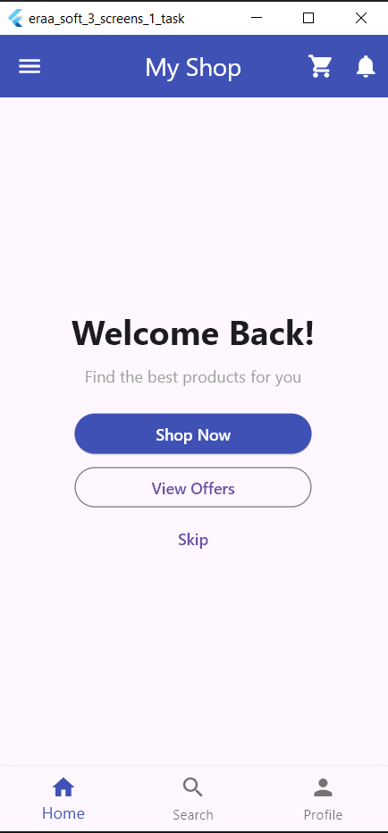
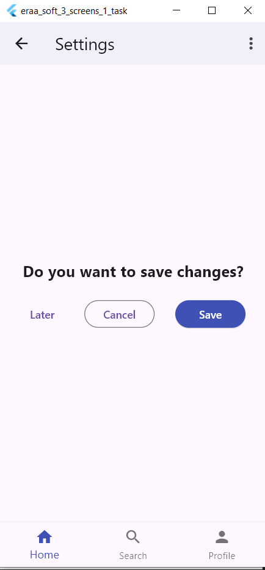
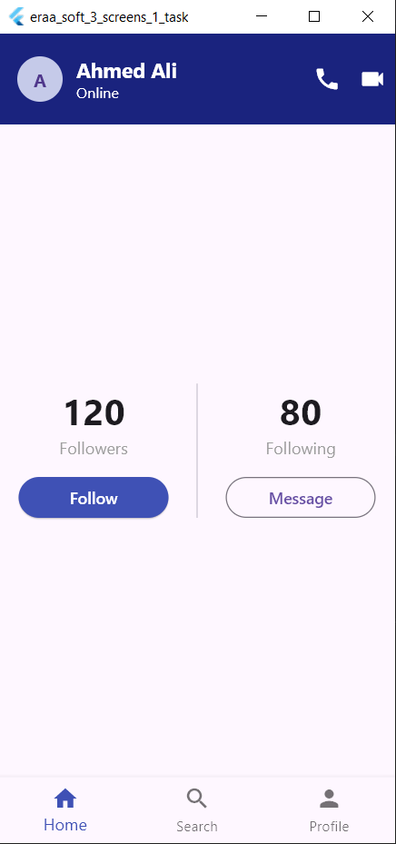

# EraaSoft Task 1 - Three Screens

## App Screenshots

  
  
  

## Getting Started

A Flutter project created as part of the EraaSoft Flutter course.

## Flutter Resources

- [Write your first Flutter app](https://docs.flutter.dev/get-started/codelab)
- [Flutter learning resources](https://docs.flutter.dev/reference/learning-resources)
- [Flutter documentation](https://docs.flutter.dev/)
